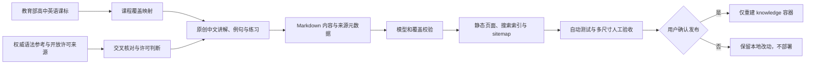

# English 高中语法内容补全技术方案

## 1. 方案结论

本次只补全 `english.dezhonger.com` 的高中语法，不重做英语站框架，不修改单词、常用表达、域名、证书或服务端路由。继续复用现有“分类树 + 学习阶段 + Markdown 内容层 + 静态生成 + 全站搜索”的能力，将教育部《普通高中英语课程标准（2017 年版 2020 年修订）》附录 3 作为覆盖基线，形成 45 个高中语法主题：补强现有 6 个主题，新增 39 个主题。

“公开可访问”不等于“允许复制”。默认不直接搬运 British Council、Cambridge、商业教材或普通教学网站的段落、例句和练习；这些网站只用于事实核对。站内正文、例句和练习采用自主编写。只有来源明确标注开放许可证且许可证与本站使用方式兼容时，才允许改编，并记录原页面、固定版本、许可证、改动说明和署名。

小学、初中、进阶本轮不扩充。现有非高中内容默认保留，只把与高中共用的混合层拆成独立高中层；如果“其他部分留空”指要删除现有小学、初中和进阶内容，需要在实施前另行确认。

## 2. 当前实现评估

### 2.1 当前事实

- 2026-09-19 实施前已执行远程引用刷新。`dezhonger-knowledge` 基线 HEAD 为 `0ea259842d603c4b9326e163b7c223e0b5c4cd74`，当时与 `origin/main` 一致；本次实现分支为 `feat/english-senior-grammar`。
- `dezhonger-service` 当前 `main` 为 `c0e0cd6ccceb85568cc68916f51889620758608e`，工作区干净且与 `origin/main` 一致；本需求预计不修改该仓库。
- 线上 `/grammar` 和 `/grammar/level/senior` 返回 HTTP 200；高中页目前只有名词、一般过去时、现在完成时、一般现在时、代词、定语从句 6 个主题。
- 本地内容模型同样只有 6 个语法主题；22 个叶子分类没有文章，其中包括非谓语动词、名词性从句、状语从句、被动语态、情态动词、虚拟语气、倒装和强调结构。
- 内容源位于 `content/english/grammar/<topic>/`，`index.md` 保存公共内容，其他 Markdown 文件保存不同学习阶段的层次内容。生成器会自动生成阶段页、分类页、文章页、目录、搜索索引、sitemap 和空状态。
- `sites/english/` 是生成结果，不应手工编辑。

### 2.2 复用与新增

| 需求数据/能力 | 已有候选及依据 | 结论 | 仍需新增及理由 |
| --- | --- | --- | --- |
| 学习阶段 | `taxonomy.json` 已有小学、初中、高中、进阶 | 直接复用 | 不新增顶层阶段 |
| 语法分类 | 已有词类、时态、句子、从句、其他 | 扩展现有分类树 | 增加冠词、数词、构词法、句子成分、基本句型、主谓一致、省略等缺失节点 |
| 语法文章 | 主题目录 + `index.md` + 分层 Markdown | 直接复用并补强 | 新增约 39 个主题目录；现有 6 个主题增加独立高中内容层 |
| 高中内部层次 | 当前只有 `senior` 粗粒度阶段 | 兼容扩展 | 为内容层增加必修、选择性必修、提高类元数据，以对应课标星级和学习顺序 |
| 覆盖证明 | 当前没有课标项目到文章的映射 | 新增 | 增加机器可校验的课程覆盖表，避免“文章很多但课标仍有遗漏” |
| 搜索、SEO、目录、响应式表格 | 现有生成器已支持 | 直接复用 | 只补充针对高中分组和来源展示的少量渲染逻辑 |
| 来源与许可 | 当前来源页主要覆盖词表和音标 | 兼容扩展 | 增加语法来源、访问日期、版本、用途和许可信息 |
| 数据库/API/后台任务 | 不需要 | 不新增 | 全部继续静态生成 |

最终新增数量为：0 个数据库表、0 个 API、0 个服务、0 个运行时配置；39 个语法主题、1 份课程覆盖映射、1 份语法来源清单，以及少量模型、渲染和测试调整。

## 3. 内容范围

覆盖范围以[普通高中英语课程标准（2017 年版 2020 年修订）](https://www.pep.com.cn/xw/zt/rjwy/gzkb2020/202205/P020220517522153664167.pdf)为准。课标明确区分：义务教育已学但高中必须在更丰富语境中熟练掌握的项目、高中必修新增项目、选择性必修项目和提高类项目。本方案不会只收录带星号的新知识，也会补齐高中阶段要求熟练运用的既有基础项目。

45 个 canonical（唯一规范 URL）主题如下，课标覆盖项不得减少。

| 模块 | 预计主题 | 数量 |
| --- | --- | ---: |
| 词类与构词法 | 名词、代词、冠词与限定词、数词、形容词、副词、介词、连词、感叹词、动词类型、情态动词、构词法 | 12 |
| 句子骨架 | 句子种类、五类短语、句子成分、基本句型、存现句、主谓一致、并列复合句 | 7 |
| 时态、体与语态 | 课标 10 种时态、时态对比与语篇时间线、被动语态 | 12 |
| 非谓语动词 | 总览、动词不定式、`-ing` 形式、`-ed` 形式 | 4 |
| 从句 | 定语从句、宾语从句、主语从句、表语从句、同位语从句、状语从句 | 6 |
| 特殊结构 | 省略、倒装、强调、虚拟语气 | 4 |

下列知识不单独扩大为本轮的新模块：直接/间接引语、标点、写作体裁和纯词汇搭配。若它们是解释某一课标语法点所必需的内容，可以放在对应文章中，但不用于宣称新增覆盖。

## 4. 内容与版权策略

### 4.1 来源分级

| 级别 | 用途 | 默认处理方式 |
| --- | --- | --- |
| 课程范围来源 | 确定高中应覆盖什么、属于哪个课程层次 | 使用课标做索引和核对，不复制大段表述 |
| 权威语法参考 | 交叉核对规则、边界和用法 | 至少两个来源交叉验证；不复制其正文、例句和练习 |
| 开放许可内容 | 在确有价值时改编 | 逐页确认许可，保存固定版本和署名，遵守相同方式共享等义务 |
| 普通公开网页或商业教材 | 仅供阅读核对 | 不移植表达性内容，不翻译改写其整段内容，不复用原例句或练习 |

Wikibooks 的大部分文本采用 CC BY-SA 4.0，可以在署名并以相同许可共享衍生内容的前提下改编；但其内容质量和完整性不一致，不能作为唯一事实来源。British Council 和 Cambridge 内容虽然公开可读，但其使用条款不支持把整套内容复制到本站，因此只作为人工核对入口。

### 4.2 本站内容规范

每个主要主题至少包含：

1. 学习目标与适用课程层次；
2. 形式：结构、词形或句法位置；
3. 意义：该形式表达什么关系；
4. 使用：在什么语境、语篇和交际目的中使用；
5. 中英双语原创例句，覆盖肯定、否定、疑问或不同语境中适用的组合；
6. 与相近知识的对比和判断步骤；
7. 至少两个常见错误及原因；
8. 小练习、答案与简要解析；
9. 相关主题链接和来源说明。

时态、非谓语和从句等核心主题原则上不少于 6 组原创例句和 3 道练习；感叹词等较小主题按实际知识范围缩减，不为满足字数制造重复内容。

## 5. 产品与数据设计

### 5.1 高中页

`/grammar/level/senior` 保留一个入口，在页内按学习依赖顺序分组：

1. 基础巩固（义务教育已学、高中必修需熟练掌握）；
2. 高中必修新增；
3. 选择性必修；
4. 提高类。

同一主题可以出现在多个组，但只指向一个详情 URL，并定位到对应内容层。例如“定语从句”文章同时包含限制性定语从句和非限制性定语从句，高中页分别从必修和选择性必修分组进入相应锚点。

### 5.2 内容源

建议在现有模型上做兼容扩展：

- `content/english/taxonomy.json`：补齐缺失分类，并增加高中课程层次枚举；
- `content/english/grammar/<topic>/index.md`：主题公共定义、总览和基础判断方法；
- `content/english/grammar/<topic>/<layer>.md`：高中必修、选择性必修或提高类内容层；
- `content/english/grammar-curriculum-map.json`：课标项目、课程层次、主题 ID、内容层 ID 的一一映射；
- `content/english/grammar-sources.json`：来源名称、URL、固定版本或访问日期、用途、许可证和署名；
- `scripts/english/model.mjs`、`types.d.ts`：校验课程层次和覆盖映射；
- `scripts/generate-english.mjs`、`render.mjs`：高中分组、锚点和来源页展示；
- `scripts/english/*.test.mjs`、`scripts/validate-english.mjs`：覆盖率、空分类、搜索和生成结果验证。

不直接修改 `sites/english/*.html`。

### 5.3 完整性校验

构建时增加以下失败条件：

- 课标覆盖表中有项目没有对应文章或锚点；
- 一个课标项目错误映射到不存在的主题、内容层或分类；
- 高中课程层次为空，或高中列表中的链接落到空状态页；
- 新增高中内容误标为小学、初中或进阶；
- 来源记录缺少 URL、用途或许可判断；
- 文章只有标题和简短定义，缺少形式、意义、使用、错误或练习中的关键部分。

## 6. 总体流程

## 7. 实施顺序

1. 先建立课标覆盖表和失败型测试，固定“完整”的定义。
2. 扩展分类树和高中内部课程层次，调整高中列表页分组；不动其他英语模块。
3. 第一批补齐词类、构词法和句子骨架，并把现有名词、代词文章拆出独立高中层。
4. 第二批补齐时态、语态和非谓语动词，并重写现有三个时态主题的高中部分。
5. 第三批补齐从句、省略、倒装、强调和虚拟语气，完善主题间的关联导航。
6. 完成来源页、覆盖报告和内容自检，再生成全部英语页面。
7. 本地预览并抽查桌面和移动端；用户已确认本次提交、推送和仅重建 `knowledge` 服务。

内容可以按三批评审，但建议全部完成并通过覆盖校验后再作为一次高中语法版本发布，避免线上长期出现“高中已完成”的入口却仍有空分类。

## 8. 验证与验收

### 8.1 自动验证

- 课标映射覆盖率为 100%，未映射项目为 0；
- 高中页约 45 个主题，所有主题和分组锚点可访问；
- 高中知识体系下不存在可点击后进入空状态的分类；
- 搜索中文名称、英文术语和常见别名可定位正确文章；
- 相关文章引用、面包屑、目录锚点、canonical、sitemap 均有效；
- 执行 `npm run check:english`；
- 执行 `npm run test:english`；
- 执行 `npm run build:english`；
- 执行 `git diff --check`。

### 8.2 内容抽查

- 每个模块至少抽查一篇，核对规则、边界、例句自然度、中文解释和答案；
- 时态重点检查“时间”与“体”的区别，不能把关键词当作机械判断规则；
- 非谓语重点检查逻辑主语、主动/被动和先后关系；
- 从句重点检查连接词在从句中是否充当成分；
- 所有错误例句必须明确标为错误，不进入搜索摘要或普通示例；
- 第三方来源不出现连续复制、翻译式改写或复用原练习的情况。

### 8.3 页面验收

- 在 360、768、1440 像素宽度检查高中入口、长表格、目录和练习答案；
- 文章无需 JavaScript 即可阅读，搜索保持现有降级行为；
- 线上发布后验证 `/grammar`、`/grammar/level/senior`、每个模块至少一个详情页、搜索索引和 sitemap；
- 内容改动只重建 `knowledge`，不重启外层 Nginx、API、数据库或证书容器。

## 9. 风险与控制

| 风险 | 控制方式 |
| --- | --- |
| 把“公开网站”误认为可复制内容 | 默认原创；改编前逐页检查许可，不清楚即不复制 |
| 文章数量多但遗漏课标 | 先建课标覆盖表，构建期强制 100% 映射 |
| 内容变成规则堆砌 | 每篇同时写形式、意义、使用和语篇场景 |
| 一个主题在多个阶段重复维护 | 一个 canonical 主题，多内容层和锚点 |
| AI 生成例句存在语病或语义不自然 | 双来源核对规则，按模块人工复核例句和答案 |
| 大量页面挤占首页或导航 | 首页仍保持现有简洁结构，完整目录放在高中语法页内 |
| 内容更新误伤其他站点 | 只修改内容源和英语生成链，部署时只重建 `knowledge` 并抽查其他内容域名 |

## 10. 已确认事项

用户已确认：

1. “其他部分留空”按“不继续补充小学、初中、进阶，但保留已有内容”执行；
2. 接受默认版权策略：公开网站用于事实核对，正文、例句和练习自主编写；只有明确开放许可的页面才做带署名的改编。

## 附录 A：评审依据

| 类型 | 资料或链接 | 核对版本或日期 | 用途 |
| --- | --- | --- | --- |
| 课程标准 | [普通高中英语课程标准（2017 年版 2020 年修订）](https://www.pep.com.cn/xw/zt/rjwy/gzkb2020/202205/P020220517522153664167.pdf) | 2026-09-19 核对附录 3 和语法知识内容要求 | 确定范围、必修/选择性必修/提高类层次和教学原则 |
| 开放内容许可 | [Wikibooks Copyrights](https://en.wikibooks.org/wiki/Wikibooks:Copyrights) | 2026-09-19 | 确认 CC BY-SA 4.0 的署名、相同方式共享和标注修改义务 |
| 开放语法参考 | [Wikibooks English Grammar](https://en.wikibooks.org/wiki/English_Grammar) | 2026-09-19 | 可选改编来源和目录参考，不作为唯一事实来源 |
| 使用条款 | [British Council Terms of use](https://www.britishcouncil.org/terms) | 2026-09-19 | 判断公开可读内容不可默认批量搬运 |
| 使用条款 | [Cambridge Terms of Use](https://www.cambridge.org/core/legal-notices/terms) | 2026-09-19 | 判断受版权保护内容的复用需许可 |
| 当前实现 | `content/english/grammar/`、`content/english/taxonomy.json` | `0ea259842d603c4b9326e163b7c223e0b5c4cd74` | 语法内容与分类基线 |
| 生成链 | `scripts/generate-english.mjs`、`scripts/english/model.mjs`、`scripts/validate-english.mjs` | 同上 | 路由、模型、搜索、SEO 和验证能力 |
| 历史方案 | `english-learning-tech-design.md`、`english-learning-validation.md` | 同上 | 复用既有英语站边界和发布方式 |

## 附录 B：仓库、分支与实现基线

| 仓库 | 用途 | 分支或引用 | 起始 commit ID |
| --- | --- | --- | --- |
| `dezhonger/dezhonger-knowledge` | 高中语法内容、分类、生成和验证 | `feat/english-senior-grammar`，从 `origin/main` 创建 | `0ea259842d603c4b9326e163b7c223e0b5c4cd74` |
| `dezhonger/dezhonger-service` | 只读确认域名与外层转发边界；预计不修改 | `main`，与 `origin/main` 同步 | `c0e0cd6ccceb85568cc68916f51889620758608e` |
